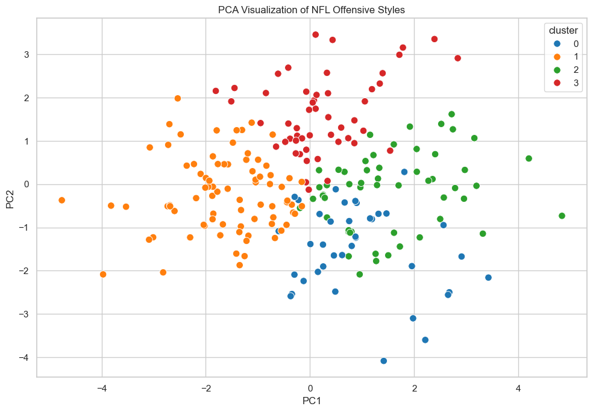
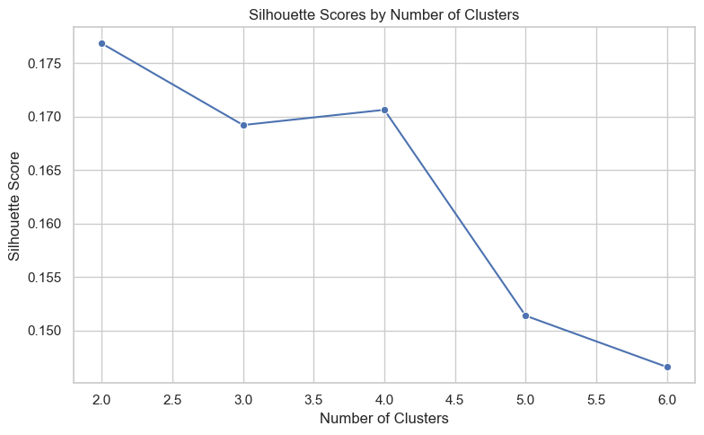
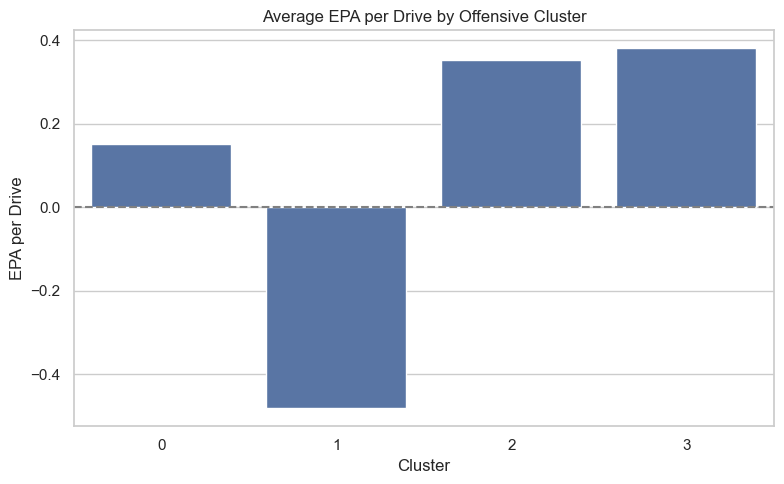
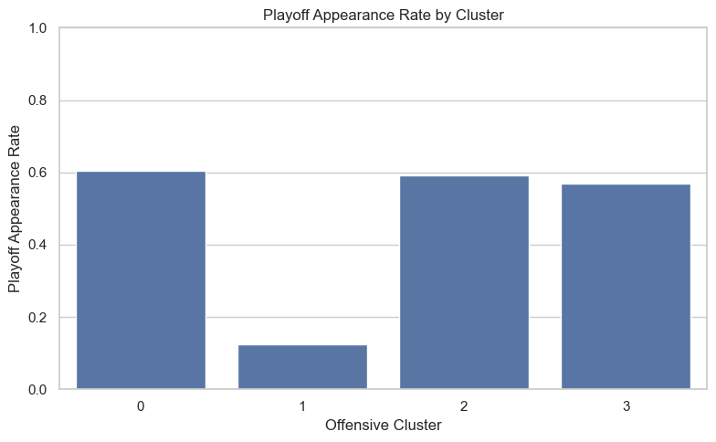
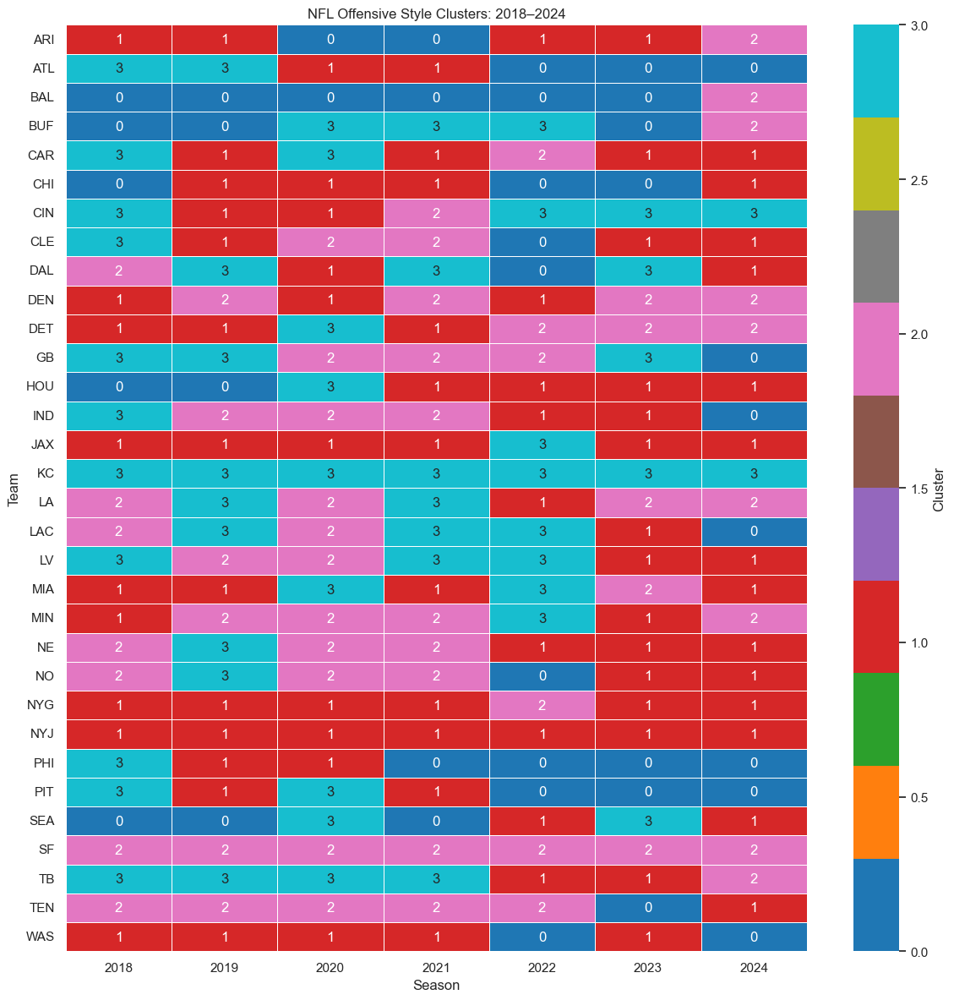
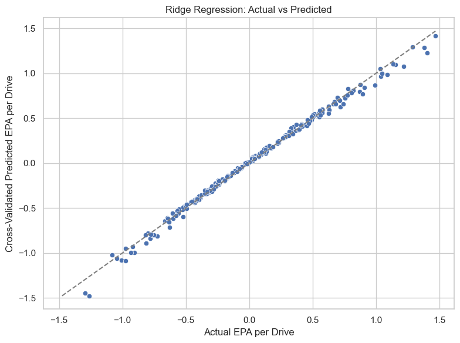
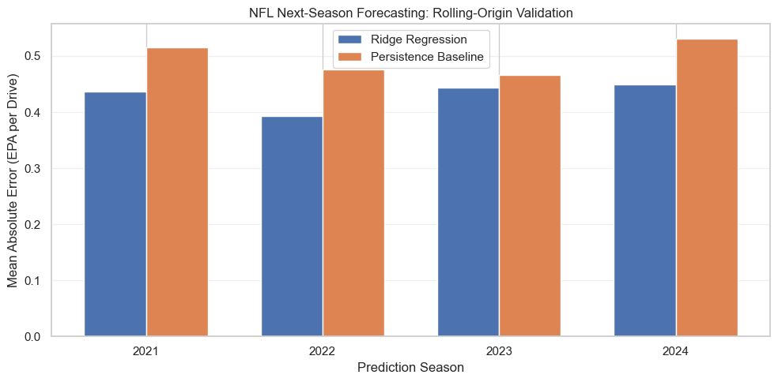

# NFL Offensive Analytics: Play-Style Clustering and Next-Season Forecasting

**An end-to-end machine learning project examining NFL offensive strategies, identifying play-style patterns, and predicting next-season offensive efficiency.**

**Technologies:** Python · pandas · NumPy · scikit-learn · Matplotlib · Seaborn · Jupyter Notebook

**Data:** NFL play-by-play, 2018–2024  
**Source:** [nflverse](https://github.com/nflverse/nflverse-data/releases/tag/pbp)

---

## Project Overview

NFL teams use different offensive strategies, including varying levels of passing, rushing, shotgun formations, play-action, and tempo. This project investigates whether those strategic differences can be quantified, grouped into meaningful offensive styles, and used to understand or predict offensive performance.

The analysis combines **unsupervised learning, regression, and chronological model validation** to address three questions:

1. Can NFL offenses be grouped into distinct strategic play styles?
2. How do offensive styles relate to efficiency and playoff appearances?
3. Can historical offensive characteristics help predict a team's efficiency in the following season?

The project builds on an academic data science analysis and extends it with out-of-sample forecasting and rolling-origin validation.

## Key Findings

| Metric | Result |
|---|---:|
| Team-season observations | 224 |
| Offensive play-style clusters | 4 |
| Year-to-year cluster retention | 49.48% |
| Same-season Ridge CV R² | 0.9937 |
| 2024 holdout Ridge R² | 0.1443 |
| 2024 holdout Ridge MAE | 0.4496 |
| 2024 persistence baseline MAE | 0.5305 |
| Rolling-origin Ridge MAE | 0.4308 |
| Rolling-origin baseline MAE | 0.4969 |
| Rolling-origin MAE improvement | **13.31%** |
| Rolling-origin seasons evaluated | 2021–2024 |
| Rolling-origin predictions | 128 |

**Main result:** The next-season Ridge forecasting model reduced mean absolute error by **13.31%** relative to a previous-season persistence baseline across four retrospective evaluation seasons.

The model outperformed the baseline in all four evaluated seasons. However, its predictive R² values were modest, indicating that substantial uncertainty remains in forecasting future offensive efficiency.

## Data and Feature Engineering

The analysis uses NFL play-by-play data from the 2018–2024 seasons, aggregated into team-season observations.

The dataset focuses on offensive plays and excludes observations without valid offensive team identifiers.

Features describe multiple dimensions of offensive strategy, including:

- Early-down passing tendencies
- Shotgun usage
- No-huddle frequency
- Rushing direction and location
- Passing depth and air yards
- Yards after catch
- Dropbacks and scrambles
- Offensive efficiency metrics

The analysis also uses offensive EPA (Expected Points Added) to measure performance.

**Primary efficiency outcome:** Offensive EPA per drive.

The final analytical dataset contains 224 team-season observations.

## Methodology

### 1. Offensive Play-Style Clustering

K-Means clustering identifies groups of NFL offenses with similar strategic characteristics.

The workflow includes feature preparation, scaling, cluster evaluation, and interpretation.

The silhouette method supports selecting **four clusters**.

The resulting groups are interpreted as broad offensive archetypes, including balanced, pass-oriented, run-oriented, and shotgun/play-action-oriented styles.

These labels are analytical interpretations rather than official NFL classifications.

### 2. Cluster Visualization and Stability

Principal Component Analysis (PCA) provides a two-dimensional representation of offensive play-style similarities.

Additional analysis examines how teams transition between clusters from one season to the next.

The observed year-to-year cluster retention rate is **49.48%**, suggesting that offensive identities exhibit both continuity and meaningful changes over time.

### 3. Descriptive Regression

Ridge Regression is used to examine relationships between offensive characteristics and same-season EPA per drive.

The descriptive model achieved:

| Metric | Result |
|---|---:|
| Cross-validated R² | 0.9937 |
| Cross-validated MAE | 0.0281 |

**Important interpretation:** This model is descriptive, not a genuine future-season forecast.

Some same-season efficiency features are mathematically related to the target, which helps explain the exceptionally high R². These results should not be interpreted as evidence that the model can predict future NFL performance with comparable accuracy.

### 4. Next-Season Forecasting

A separate forecasting model predicts offensive EPA per drive in season *t + 1* using information available from season *t*.

This approach avoids using future-season information as input.

A chronological holdout evaluation uses 2024 as the test season.

| Metric | Ridge Regression | Persistence baseline |
|---|---:|---:|
| 2024 MAE | 0.4496 | 0.5305 |
| 2024 R² | 0.1443 | -0.1836 |

The Ridge model achieved a **15.25% reduction in MAE** compared with the persistence baseline in the 2024 holdout.

The persistence baseline predicts that a team's next-season offensive efficiency will equal its previous-season efficiency.

### 5. Rolling-Origin Validation

To evaluate whether the forecasting improvement extends beyond one season, the project uses expanding-window, rolling-origin validation.

For each evaluation season, the model is trained only on observations whose target seasons precede the evaluation season.

| Evaluation season | Ridge MAE | Baseline MAE | Ridge R² |
|---|---:|---:|---:|
| 2021 | 0.4372 | 0.5156 | 0.1453 |
| 2022 | 0.3930 | 0.4757 | -0.0749 |
| 2023 | 0.4432 | 0.4657 | 0.0436 |
| 2024 | 0.4496 | 0.5305 | 0.1443 |
| **Overall** | **0.4308** | **0.4969** | — |

Across 128 predictions, Ridge Regression improved MAE by **13.31%** and outperformed the persistence baseline in all four evaluation seasons.

These results support a modest, repeatable improvement over a simple benchmark within the evaluated historical period. They do not establish strong forecasting accuracy or guarantee future performance.

## Visualizations

The repository includes the following figures generated by the analysis.

### Offensive Play-Style Clusters



PCA visualization of team-season observations colored by their assigned offensive cluster.

### Cluster Selection



Silhouette scores used to evaluate candidate cluster counts.

### Offensive Efficiency by Cluster



Comparison of offensive EPA per drive across the identified play-style groups.

### Playoff Appearance Rates



Descriptive comparison of playoff appearance rates across offensive clusters. These associations do not establish causation.

### Offensive Style Transitions



Year-to-year transitions between offensive play-style clusters.

### Regression Predictions



Visualization of actual and predicted offensive efficiency in the regression analysis.

### Rolling-Origin Forecasting Performance



Comparison of Ridge Regression and persistence baseline MAE across the four evaluation seasons.

## Repository Structure

```text
nfl-offensive-analytics-ml/
|
|-- README.md
|-- requirements.txt
|-- download_data.py
|-- .gitignore
|
|-- docs/
|   |-- academic_report.pdf
|   |-- academic_slides.pdf
|
|-- notebooks/
|   |-- original_academic_analysis.ipynb
|   |-- portfolio_analysis.ipynb
|
|-- outputs/
|   |-- figures/
|   |   |-- pca_clusters.png
|   |   |-- silhouette_scores.png
|   |   |-- cluster_epa_per_drive.png
|   |   |-- playoff_rate_by_cluster.png
|   |   |-- cluster_transitions.png
|   |   |-- ridge_predictions.png
|   |   |-- rolling_origin_mae_comparison.png
|   |
|   |-- tables/                 # Generated locally
|
|-- data/                       # Downloaded locally; excluded from Git
```

The `portfolio_analysis.ipynb` notebook contains the extended portfolio analysis, including chronological forecasting and rolling-origin validation.

The `original_academic_analysis.ipynb` notebook preserves the earlier academic work.

## Reproduce the Analysis

This project uses publicly available NFL play-by-play data from the [nflverse project](https://github.com/nflverse/nflverse-data/releases/tag/pbp), covering the 2018–2024 seasons.

Raw datasets are intentionally excluded from this repository because of their size.

Follow the steps below to download the data and execute the analysis independently.

### 1. Clone the repository

```bash
git clone https://github.com/jorgebr77/nfl-offensive-analytics-ml.git
cd nfl-offensive-analytics-ml
```

Alternatively, download the repository using **Code → Download ZIP** on GitHub and extract the contents.

### 2. Set up the Python environment

Requires Python 3.10 or newer.

On Windows PowerShell:

```powershell
python -m venv .venv
.\.venv\Scripts\Activate.ps1
python -m pip install --upgrade pip
python -m pip install -r requirements.txt
```

If PowerShell prevents environment activation, the environment's Python executable can be used directly:

```powershell
.\.venv\Scripts\python.exe -m pip install -r requirements.txt
```

### 3. Download the NFL datasets

Run the included download script:

```powershell
python download_data.py
```

The script retrieves the seven season-specific Parquet files from nflverse and saves them into the local `data/` directory:

```text
data/
  play_by_play_2018.parquet
  play_by_play_2019.parquet
  play_by_play_2020.parquet
  play_by_play_2021.parquet
  play_by_play_2022.parquet
  play_by_play_2023.parquet
  play_by_play_2024.parquet
```

**Alternative:** If the datasets are already stored elsewhere, set the `NFL_DATA_DIR` environment variable before launching Jupyter:

```powershell
$env:NFL_DATA_DIR = 'C:\path\to\your\parquet-folder'
```

### 4. Run the notebook

```powershell
python -m jupyter notebook notebooks/portfolio_analysis.ipynb
```

Select the Python kernel associated with the project environment.

Then choose **Kernel → Restart & Run All**.

The analysis generates tables in `outputs/tables/` and figures in `outputs/figures/`.

### 5. Verify the results

Compare the generated outputs with the following reference values:

| Metric | Reference result |
|---|---:|
| Team-season observations | 224 |
| Offensive clusters | 4 |
| Cluster retention | 49.48% |
| 2024 Ridge MAE | 0.4496 |
| 2024 baseline MAE | 0.5305 |
| Rolling-origin Ridge MAE | 0.4308 |
| Rolling-origin baseline MAE | 0.4969 |
| Rolling-origin MAE improvement | 13.31% |
| Rolling-origin predictions | 128 |

Results should be compared using the same metric definitions and evaluation periods.

### Data Compatibility and Reproducibility Notes

The notebook expects specific input fields defined in `REQUIRED_COLUMNS`.

Public nflverse datasets may change over time due to updates, corrections, or schema revisions. As a result, downloading the latest datasets may produce different numerical results or require preprocessing adjustments.

Exact numerical reproduction may require the original data versions and compatible dependency versions.

The `download_data.py` script retrieves currently published nflverse files; it does not freeze a historical dataset snapshot.

Independent clean-environment execution has now been verified on both a work laptop and a home computer. See the verification results below. Exact bit-for-bit reproduction is not claimed.

## Reproducibility Verification

### Independent Home-Computer Test — November 8, 2026

A fresh copy of the public GitHub repository was downloaded and executed on a Windows home computer using **PowerShell**, **Python 3.11.9**, and a new, isolated **`venv`** environment. No files from the original development dataset were copied into the test directory.

The verification followed these steps:

1. Downloaded the repository ZIP from GitHub and extracted it into a separate testing directory.
2. Created a new `.venv` environment using Python 3.11.9.
3. Installed `requirements.txt` dependencies plus Jupyter Notebook and `ipykernel`; `pip check` reported no broken requirements.
4. Ran `download_data.py` to retrieve all seven 2018–2024 play-by-play Parquet files directly from nflverse.
5. Ran `notebooks/portfolio_analysis.ipynb` using the isolated environment and inspected the saved outputs.
6. Confirmed that all substantive code cells had execution counts and no saved execution-error outputs.

**Outcome:** Successful clean-environment execution, with closely matching numerical results and the same principal analytical conclusions.

### Original Analysis vs. Home Verification

| Metric | Original analysis | Home verification |
|---|---:|---:|
| Team-season observations | 224 | 224 |
| Offensive clusters | 4 | 4 |
| Year-to-year cluster retention | 49.48% | 49.48% |
| Same-season Ridge CV R² | 0.9937 | 0.9938 |
| 2024 holdout Ridge MAE | 0.4496 | 0.4505 |
| 2024 persistence baseline MAE | 0.5305 | 0.5314 |
| Rolling-origin Ridge MAE | 0.4308 | ~0.4310 |
| Rolling-origin persistence baseline MAE | 0.4969 | 0.4972 |
| Rolling-origin MAE improvement | 13.31% | 13.32% |
| Seasons with lower Ridge MAE | 4/4 | 4/4 |
| Rolling-origin predictions | 128 | 128 |

The home test also agreed closely with an earlier independent work-laptop test using an Anaconda environment. Minor differences from the original results remain unexplained; changes in upstream data or package versions are possible factors, not confirmed causes.

These results support **technical reproducibility** and **close numerical agreement**, not exact bit-for-bit reproduction or guaranteed compatibility with future data and software releases. The 13.32% improvement refers to a reduction in *mean absolute forecasting error* relative to the persistence baseline, not a prediction accuracy percentage.

### Recording the Home Environment

To preserve the software versions used in the home verification, run these commands from the repository root in **Windows PowerShell**:

```powershell
.\.venv\Scripts\python.exe -m pip freeze > environment-home.txt
.\.venv\Scripts\python.exe -c "import sys, platform; print('Python:', sys.version); print('Operating system:', platform.platform())" > environment-system-home.txt
```

The resulting files are saved **beside `README.md` and `requirements.txt`** in the repository root:

- `environment-home.txt` — exact installed Python package versions, including notebook tools.
- `environment-system-home.txt` — Python version and Windows platform information.

These files are generated locally; **include them in the GitHub commit if you want the environment snapshot publicly available**. The `.venv/` directory and downloaded `data/` files should remain excluded from version control. The general `requirements.txt` remains the project's primary dependency specification; the environment files document a particular successful run.

## Limitations

Several limitations are important when interpreting the findings.

**Small sample size:** The analysis contains 224 team-season observations, limiting statistical power and model complexity.

**Observational data:** Relationships between offensive style, efficiency, and playoff appearances are descriptive and do not establish causal effects.

**Cluster interpretation:** K-Means identifies statistical similarities. Offensive archetype labels are interpretations rather than definitive categories.

**Cluster stability:** Team strategies, coaching staffs, personnel, and league-wide trends can change across seasons.

**Descriptive model leakage risk:** The high same-season regression R² is partly explained by features closely related to the target and should not be confused with predictive forecasting performance.

**Limited forecasting power:** The next-season model improves on the persistence baseline but produces modest R² values, including a negative R² in one rolling-origin evaluation season.

**Retrospective validation:** Rolling-origin results provide historical robustness evidence but are not equivalent to an untouched prospective evaluation on future seasons.

**Data version sensitivity:** Updated nflverse data may alter preprocessing, model estimates, and reported results.

## Future Improvements

Potential extensions include:

- Incorporating coaching changes, quarterback availability, roster continuity, and injuries.
- Evaluating additional forecasting models, including tree-based methods.
- Testing feature importance and model interpretability.
- Comparing offensive archetypes across coaching systems and seasons.
- Expanding chronological evaluation to newer NFL seasons.
- Improving data version tracking and automated reproducibility checks.
- Developing an interactive dashboard for exploring offensive styles and forecasting results.

## Academic Background

This project originated as a graduate-level data science analysis and was subsequently expanded into a portfolio project emphasizing predictive modeling, chronological validation, and transparent interpretation.

The original academic report and presentation are available in the `docs/` directory.

## Tools and Technologies

**Programming and analysis:** Python, pandas, NumPy

**Machine learning:** scikit-learn, K-Means, PCA, Ridge Regression

**Visualization:** Matplotlib, Seaborn

**Development:** Jupyter Notebook, Git, GitHub

**Data source:** nflverse / nflfastR NFL play-by-play data

## Author

**Jorge Benitez**

M.S. in Data Science — University of Colorado Boulder

Interested in applying machine learning, statistical modeling, and data-driven decision-making to sports analytics and business problems.

[GitHub Profile](https://github.com/jorgebr77)

---

**Project takeaway:** NFL offensive strategies can be grouped into interpretable play-style categories, and historical offensive characteristics provide some predictive value for next-season efficiency. Chronological validation suggests that Ridge Regression can outperform a simple persistence benchmark, while the remaining forecasting uncertainty highlights the complexity of predicting NFL performance.
